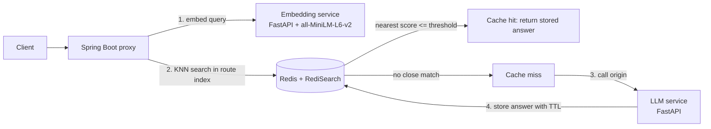

# Semantic Caching Layer

A caching service for LLM-backed APIs that answers repeated questions from **meaning**, not exact text. Similar queries are served from Redis in about **46 ms** instead of waiting about **2.4 s** for an LLM call, and a per-route design keeps time-sensitive queries from getting wrong cached answers.

> **Cache hits: ~46 ms median vs ~2.4 s for LLM calls (about 50x faster, 98% lower latency).**

## Highlights

- Semantic matching with sentence embeddings (`all-MiniLM-L6-v2`) and Redis vector search (RediSearch, KNN).
- **Per-route similarity thresholds and TTLs**, because different queries tolerate different amounts of fuzziness.
- Route isolation: each route has its own vector index, so queries are only compared with entries from their own route.
- Evidence-driven design: the route split came from measured distances, including a deliberately confusable pair (UPI PIN vs ATM PIN) and time-shifted queries.

## The problem

An exact-match cache misses "How do I reset my password?" vs "I forgot my password, how can I change it?". A semantic cache catches these, but a naive one has a serious flaw: embedding models capture the *topic* of a query well and its *time, date or number* poorly.

In the tests, "weather in India today" vs "weather in India tomorrow" scored a distance of **0.114**, which is inside the 0.15 threshold that works well for paraphrases. A single global threshold would serve yesterday's weather as today's. This project routes queries by **how much a small wording change alters the correct answer**.

## How it works



1. The proxy receives a query for a route (`faq` or `typical`).
2. The query is embedded by the Python service.
3. A KNN search runs in that route's index. If the nearest distance is at or below the route's threshold, the stored answer is returned.
4. On a miss, the LLM service is called and the answer is stored with the route's TTL.

Distances are vector distances: **lower means more similar**. Identical queries score about 0.

## Routes

| Route | Use for | Threshold | TTL | Behaviour |
| --- | --- | ---: | --- | --- |
| `faq` | Stable questions where paraphrases share one answer | 0.15 | Longer-lived | Tolerates rewording |
| `typical` | Answers that change with time, date, number or place, and personalised answers | 0.02 | 10 s | Near-exact repeats only |

Thresholds and TTLs are configured per route in `application.properties`. Redis keys follow `{routeId}:{UUID}` and indexes follow `cache_idx_{routeId}`.

## Performance

| Measure | Cache hits (n=7) | LLM misses (n=17) |
| --- | ---: | ---: |
| Average latency | 47.9 ms | 2,404 ms |
| Median latency | 46 ms | 2,257 ms |
| Range | 38 to 67 ms | 956 to 4,919 ms |

- **About 50x faster** overall (98% latency reduction).
- On the FAQ route alone, hits averaged 44 ms vs 2.9 s for misses, about 65x.
- Hit latency is end to end, including embedding and the Redis search.
- Every hit also avoids one LLM API call.
- Miss latency depends on the LLM provider and the machine (measured locally against Groq), so treat the ratio as indicative.

## Evaluation

About 24 requests across both routes. This is a small, hand-built test set meant to probe boundaries, not a benchmark, so no hit rate is reported.

### FAQ route (threshold 0.15)

| Query pair | Distance | Result |
| --- | ---: | --- |
| "I forgot my password, how can I change it?" vs stored password-reset entry | 0.106 | Hit |
| "How to reset ATM PIN?" vs stored ATM entry | 0.006 | Hit |
| "What are tuples in Python?" vs "What is a tuple in Python?" | 0.061 | Hit |
| "Python list vs tuple" vs "Difference between list and tuple in Python" | 0.058 | Hit |
| Exact repeat of "How to reset UPI PIN?" | about 0 | Hit |
| "How to reset UPI PIN?" vs "How to reset ATM PIN?" (confusable pair) | 0.237 | Miss (correct) |
| "What was the price of Bitcoin yesterday?" vs "What is the price of Bitcoin?" | 0.159 | Miss (just above threshold) |
| Verbose rephrasing of "What is Spring Boot?" | 0.167 | Miss (false miss) |
| Unrelated queries | 0.49 to 0.89 | Miss |

### Typical route (threshold 0.02, TTL 10 s)

| Query pair | Distance | Result |
| --- | ---: | --- |
| "how to reset upi pin" vs stored "How to reset UPI PIN?" (case and punctuation differ) | 0.0 | Hit |
| "weather in India tomorrow" vs stored "weather in India today" | 0.114 | Miss (correct) |
| "How to reset ATM PIN?" vs stored UPI PIN entry | 0.237 | Miss (correct) |

## Key findings

1. **Paraphrases and unrelated queries separate cleanly.** True paraphrases scored 0.006 to 0.106 and unrelated queries 0.49 or higher, so 0.15 sits comfortably between them.
2. **The embedding model does not reliably encode time.** "Today" vs "tomorrow" scored 0.114 and "price of Bitcoin" vs "price of Bitcoin yesterday" scored 0.159. Both are at or inside the FAQ threshold, which is why time-sensitive queries need the tight `typical` route.
3. **A false miss is cheap and a false hit is costly.** A false miss costs a few seconds. A false hit returns a wrong answer. In the overlap zone (about 0.15 to 0.17) the cache errors toward missing.
4. **Confusable pairs are separable, with a modest margin.** A true paraphrase scored 0.162 (ATM vs "Automated Teller Machine") and a wrong pair scored 0.237 (UPI PIN vs ATM PIN).

## Tech stack

Java, Spring Boot, Python, FastAPI, sentence-transformers (`all-MiniLM-L6-v2`), Redis 8.6.1 with RediSearch, Lombok.

## Project structure

```
.
├── SemanticCaching/      # Spring Boot orchestrator (routes, thresholds, Redis access)
├── Python-microservice/    # FastAPI embedding service + LLM origin service
└── README.md
```

<!-- Rename the folders above to match your repo. -->

## Running locally

**Prerequisites:** Java 17+, Maven, Python 3.10+, Redis 8.x with RediSearch.

```bash
# 1. Start Redis
redis-server

# 2. Start the Python service (embeddings + LLM origin)
cd python-service
pip install -r requirements.txt
export LLM_API_KEY=<your-key>
uvicorn main:app --port 8002

# 3. Start the Spring Boot proxy
cd spring-proxy
./mvnw spring-boot:run
```

API keys are read from environment variables and are never committed.

### Configuration

Per-route thresholds and TTLs live in `application.properties`. Use your own property names here, for example a threshold and a TTL for each of `faq` and `typical`.

### Example request

```
POST http://localhost:8080/api/L1/query/request/{routeId}
```

Example response:

```json
{
  "answer": "...",
  "cacheHit": true,
  "latencyMs": 46,
  "query": "How to reset UPI PIN?"
}
```

## Limitations

- Evaluated on about 24 requests with a single embedding model, so the thresholds are empirical, not universal.
- A threshold alone cannot separate every boundary case, such as a verbose paraphrase from a time-shifted query.
- Refusal and error answers from the LLM are currently stored like any other answer.
- The nearest distance is logged but not returned in the response on misses.
- No load or concurrency testing yet, for example simultaneous identical queries.

## Future work

- Do not cache failed or refusal responses.
- Bypass the cache before embedding for time-sensitive words (today, yesterday, now).
- Larger labelled evaluation set with a threshold sweep per route.
- Request coalescing for simultaneous identical queries.

